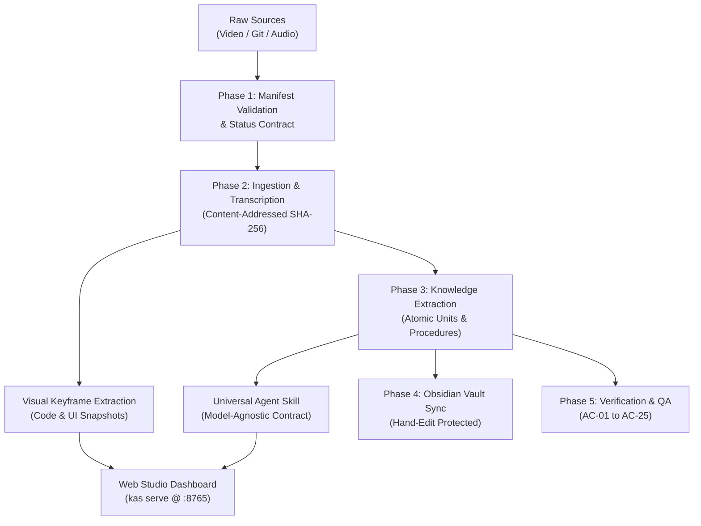

# Knowledge Acquisition Studio (KAS)

<p align="center">
  <strong>Autonomous Multimodal Video-to-Agent Skill Engine</strong><br>
  <em>Transforms long-form tutorials, code repositories, and documentation into model-agnostic, executable skills for AI agents.</em>
</p>

<p align="center">
  
  
  
  
  
</p>

---

## ⚡ What is Knowledge Acquisition Studio?

Knowledge Acquisition Studio (KAS) is an autonomous knowledge engine designed to extract production-ready skills for AI agents from dense real-world sources—including video tutorials, Git codebases, podcasts, and technical documentation.

Instead of generic text summaries or chat transcripts, KAS generates:
1. **Model-Agnostic Agent Skills (`*.skill.md`)**: Executable procedure contracts designed for any modern LLM (Claude, GPT-4, Gemini, DeepSeek, Qwen, Llama, or Antigravity).
2. **Atomic Knowledge Units (`units.json`)**: Decontextualized, claim-level knowledge primitives with strict provenance and confidence scores.
3. **Timestamped Action Notes (`notes.json`)**: Minute-by-minute action descriptions synchronized with source timestamps.
4. **Visual Keyframe Screenshots**: High-resolution snapshots extracted via `ffmpeg` capturing code blocks, terminals, architecture diagrams, and UI interactions.
5. **Obsidian Vault Projections**: Formatted Markdown notes with frontmatter, Wikilinks, and hand-edit preservation guards.

---

## 🚀 Key Features

* **Universal Skill Generation**: Directives and procedures are formulated without vendor-lock, following the standard *Context-Task-Format* prompt pattern and tool-calling interfaces.
* **Multimodal Ingestion**:
  * 🎥 **Videos**: YouTube streaming or local MP4/MKV video files.
  * 🐙 **Git Repositories**: Remote GitHub repos or local directories (`file:///...`), extracting architectures, manifests, and documentation.
  * 🎙️ **Audio**: Podcasts and lectures (MP3, WAV, M4A).
  * 📄 **Documents**: PDF, Markdown, and HTML.
* **Automated Visual Keyframes**: Intelligent keyword-based heuristic detects demonstrations of code, terminal outputs, workflows, and diagrams, extracting exact video frames with sub-second precision.
* **Interactive Web Studio (`kas serve`)**:
  * Synchronized video player jumping to demonstrations on timestamp click.
  * Full-resolution screenshot lightbox with instant video seeking.
  * Searchable atomic units and procedures browser with one-click clipboard copying.
  * Live 25/25 QA Acceptance Criteria matrix.
  * Built-in LAN sharing (`0.0.0.0`) with automatic local IP detection.
* **Web UI Project Creator**: Create, configure, and auto-ingest new knowledge projects directly from the browser without touching the command line.
* **Strict Provenance & Idempotency**: Content-addressed SHA-256 storage prevents duplicate work and raw file overwrites (AC-01 through AC-25 compliance).
* **Zero External Runtime Dependencies**: Core engine runs entirely on the Python Standard Library (with optional `yt-dlp` and `ffmpeg` for video handling).

---

## 🏗️ Architecture & 5-Phase Pipeline



### The 5 Phases
1. **Phase 1 — Foundation**: Validates `manifest.yaml` schema, checks credentials, and prepares project workspace. Fails before writing any file if inputs are invalid.
2. **Phase 2 — Ingest & Transcribe**: Ingests raw bytes into content-addressed IDs (`src-<sha256>`), transcribes audio/video or parses repo trees, and builds action notes.
3. **Phase 3 — Extract & Formulate**: Extracts atomic knowledge units, normalizes them against conflicts, and synthesizes step-by-step agent procedures.
4. **Phase 4 — Vault Projection**: Generates an Obsidian-compatible knowledge vault with backlinks, frontmatter, and conflict-detection guards for human edits.
5. **Phase 5 — QA Verification**: Validates all 25 acceptance criteria (AC-01 through AC-25), verifies unit references, and produces the final application report.

---

## 🛠️ Quickstart

### 1. Installation

```bash
git clone https://github.com/<your-username>/knowledge-acquisition-studio.git
cd knowledge-acquisition-studio

# Create virtual environment
python3 -m venv .venv
source .venv/bin/activate

# Install in development mode
pip install -e .
```

*Optional requirements for video keyframe extraction:*
```bash
sudo apt install ffmpeg
pip install yt-dlp
```

---

### 2. Launch the Interactive Web Studio

Start the web studio with local and LAN access:

```bash
kas serve --host 0.0.0.0 --port 8765
```

Open your browser:
* **Local:** `http://localhost:8765/`
* **LAN:** `http://<your-local-ip>:8765/`

From the web UI, you can:
* Click **`+ New Project`** to create and auto-ingest a new project.
* Browse notes, atomic units, and executable procedures.
* Click any timestamp to jump the video player to the exact scene.
* Click **📸 Visual Keyframes** to inspect code snapshots in the high-res lightbox.
* Click **Export Agent Skill** to download the universal `*.skill.md` file.

---

### 3. Command Line Interface (CLI)

```bash
# Validate manifest and environment credentials
kas validate --project projects/claude-tutorial

# Ingest raw source content
kas ingest --project projects/claude-tutorial

# Run full pipeline (transcription, extraction, procedure synthesis)
kas build --project projects/claude-tutorial

# Project knowledge into an Obsidian vault
kas vault --project projects/claude-tutorial --vault ~/Documents/ObsidianVault

# Verify acceptance criteria and generate QA report
kas qa --project projects/claude-tutorial

# Run autonomous watch daemon
kas daemon --project projects/claude-tutorial
```

---

## 🤖 Universal Agent Skill Output

When you export a skill from KAS, it produces a clean, model-agnostic specification compatible with any LLM runner:

```markdown
---
name: claude-tutorial
description: Learn LLM fundamentals, prompt engineering, and autonomous workflows
version: 1.0.0
tags: [agent-skill, workflow, universal-llm, procedure]
compatibility: [claude, gpt-4, gemini, qwen, deepseek, llama, antigravity]
---

# Skill: claude-tutorial

## Agent Execution Contract
1. Adopt the Context-Task-Format prompting architecture for clear deliverables.
2. Execute tool integrations via standard Model Context Protocol (MCP) or tool-calling interfaces.
3. Follow the ordered, imperative steps sequentially and verify intermediate state.

## Core Procedures
### Building Custom Tool Integrations
- Define the JSON schema for input arguments and output results.
- Implement permission boundary checks prior to executing file or network calls.
- Execute the request and validate output conformance against schema.

## Knowledge Primitives & Rules
- **k-18a803f274a4**: LLM Projects provide isolated workspaces with persistent instructions and reference files.
- **k-908bcdaee675**: Markdown heading structure enables LLMs to parse complex documents with higher accuracy.
```

---

## 🔌 REST & MCP API

The server exposes HTTP endpoints for agent tool integrations:

| Method | Endpoint | Description |
|---|---|---|
| `GET` | `/api/projects` | List all available knowledge projects with metadata |
| `GET` | `/api/project?name=<id>` | Retrieve full project data (notes, units, procedures, keyframes) |
| `POST` | `/api/project/create` | Create a new project workspace and optionally run auto-ingest |
| `GET` | `/api/skills?q=<query>` | Search procedures and atomic units by semantic query |
| `GET` | `/api/export/skill?path=<path>` | Download the universal `*.skill.md` document |
| `POST` | `/api/keyframes/extract` | Trigger sub-second `ffmpeg` keyframe extraction for a project |
| `GET` | `/media/<project>/<path>` | Serve visual keyframe screenshots and local media |

---

## 🧪 Testing

The test suite covers manifest validation, path confinement, content addressing, adapters, pipeline idempotency, and server endpoints:

```bash
.venv/bin/pytest -v
```

```
============================== 98 passed in 1.18s ==============================
```

---

## 📂 Project Structure

```
knowledge-acquisition-studio/
├── src/kas/
│   ├── adapters/          # Ingestion adapters (video, git, audio, text)
│   ├── cli.py             # Unified CLI interface
│   ├── config.py          # Configuration schema & credential validation
│   ├── extract.py         # Knowledge extraction & prompt synthesis
│   ├── ids.py             # Content-addressed hashing & ID generation
│   ├── ingest.py          # Ingest runner & raw byte management
│   ├── keyframes.py       # Visual screenshot extractor via ffmpeg
│   ├── manifest.py        # Manifest schema & strict key validation
│   ├── models.py          # Dataclasses (SourceRecord, Transcript, Note, Unit)
│   ├── paths.py           # Path confinement & security boundaries
│   ├── pipeline.py        # 5-phase build orchestrator
│   ├── qa.py              # Automated 25-criteria acceptance testing
│   ├── server.py          # Web Studio HTTP server & REST API
│   ├── status.py          # Status contract & progress logging
│   └── vault.py           # Obsidian vault projection & sync
├── projects/              # Project workspaces (manifests, sources, knowledge)
├── tests/                 # Automated test suite (98 tests)
└── pyproject.toml         # Package definition (zero runtime dependencies)
```

---

## 📄 License

MIT License. Designed and engineered for autonomous AI agent ecosystems.
